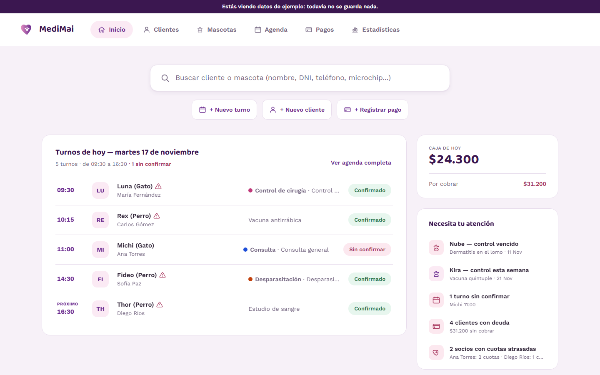
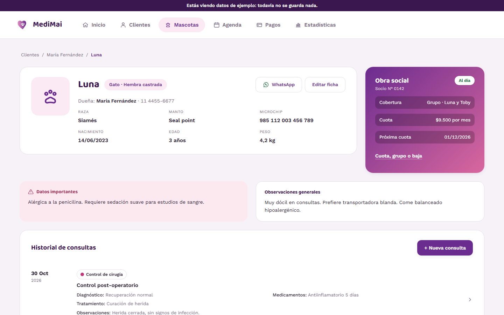
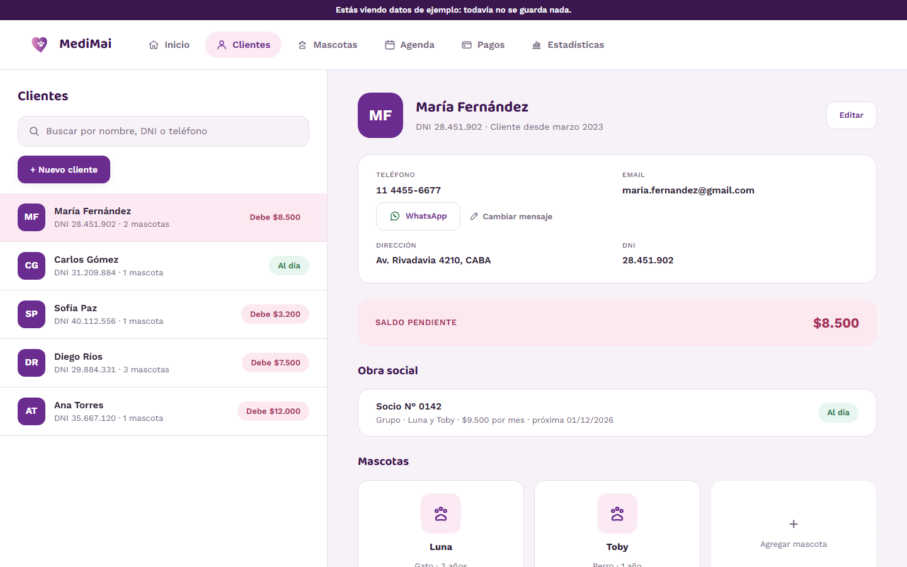
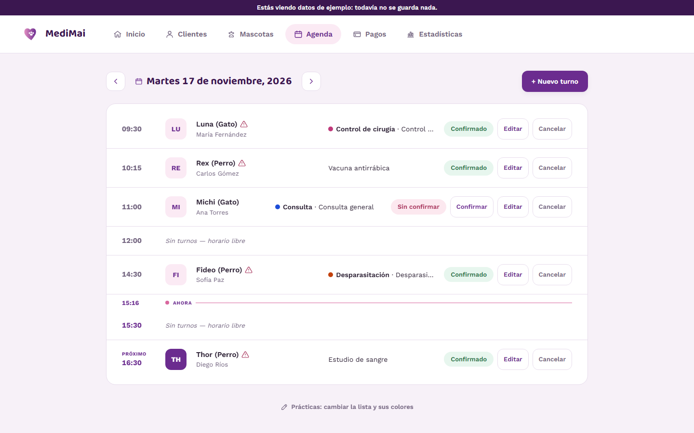
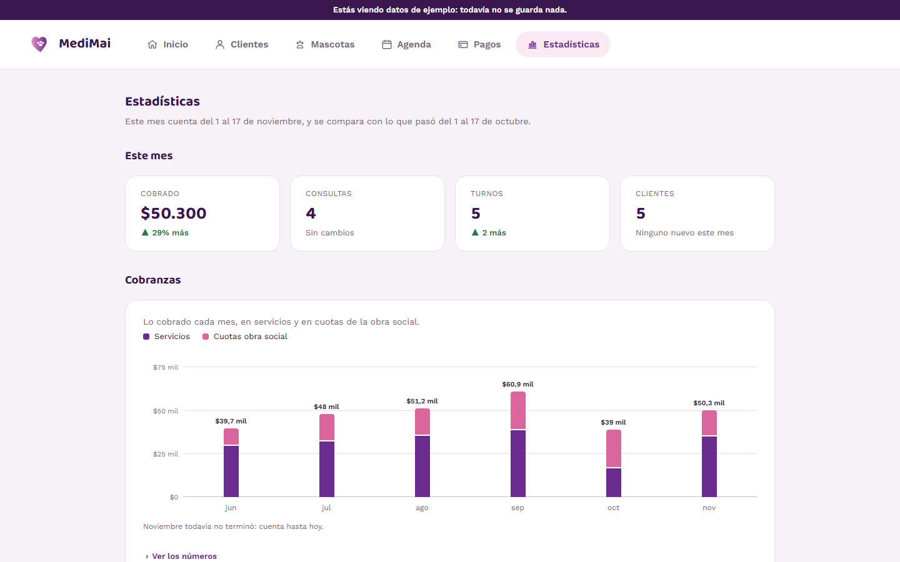
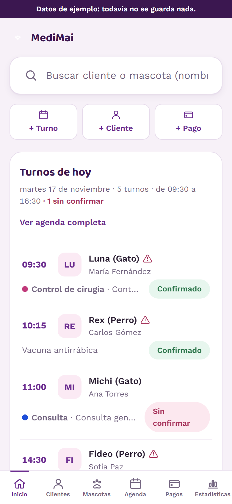
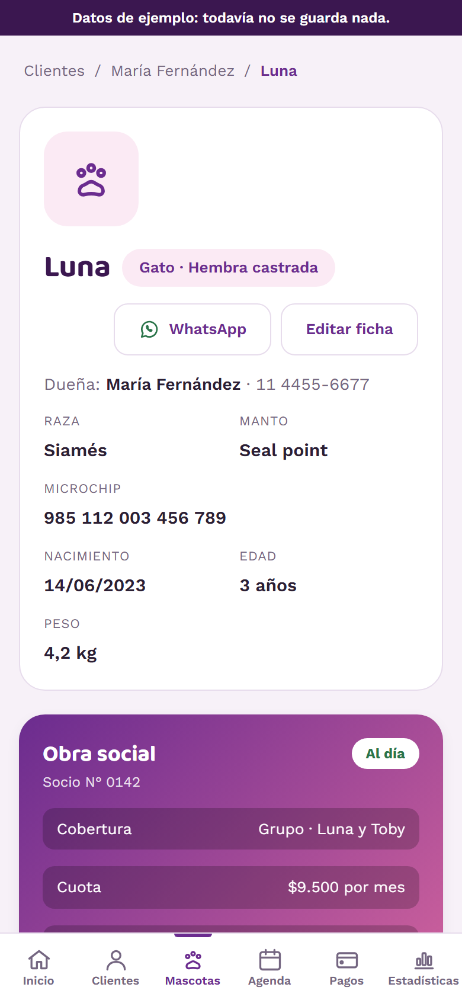
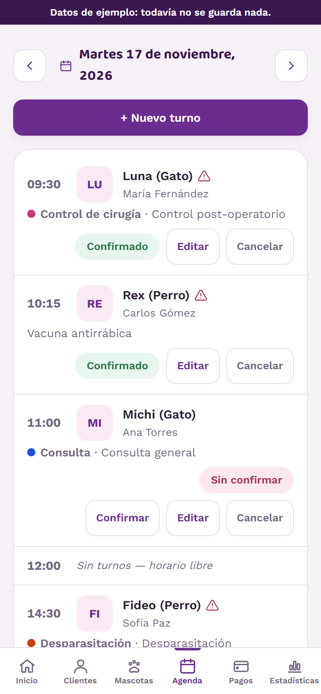
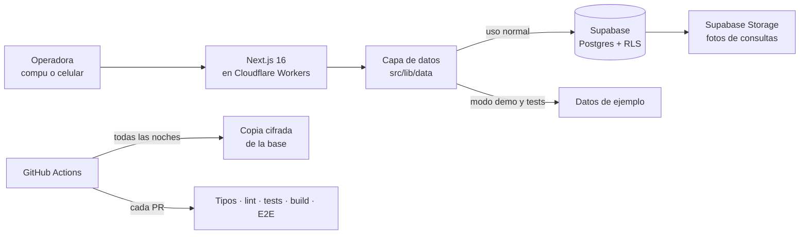

# MediMai · sistema de gestión para una veterinaria

> **Caso de estudio.** El código es privado porque el sistema está en uso y guarda datos
> reales de clientes. Todas las capturas son del **modo demostración**, con personas y
> mascotas inventadas.

Sistema hecho a medida para una veterinaria chica que trabajaba con fichas en papel y otro
programa: **clientes, mascotas, historia clínica, turnos, pagos y obra social** en una sola
app que usa una persona desde la computadora o el celular.

## El problema

- Las historias clínicas estaban en otro sistema (MascotaMás) que **no permite exportar** en bloque.
- La veterinaria tiene una **obra social propia** (cuotas mensuales por grupo de mascotas) y no había
  forma fácil de saber quién estaba atrasado.
- El presupuesto para infraestructura era **$0 por mes**.

## La solución

| | |
|---|---|
| **Inicio** | Buscador global, turnos de hoy, caja del día y una lista de lo que necesita atención: controles vencidos, turnos sin confirmar, deudas y cuotas atrasadas. |
| **Clientes y mascotas** | Fichas completas, saldo calculado, obra social, datos importantes destacados (alergias) y unión de fichas duplicadas. |
| **Historia clínica** | Consultas con diagnóstico, tratamiento, medicamentos y fotos. |
| **Agenda** | Turnos por día con prácticas de colores, confirmación y huecos libres. |
| **Pagos y obra social** | Cobros, deudas y estado de cuotas de cada socio. |
| **Estadísticas** | Cobranzas por mes (servicios y cuotas), consultas, turnos y especies. |
| **WhatsApp** | Mensajes armados para escribirle al cliente con un toque. |

Todos los números se calculan a partir de los datos. Ninguno está escrito a mano.

<table>
  <tr>
    <td></td>
    <td></td>
  </tr>
  <tr>
    <td></td>
    <td></td>
  </tr>
</table>

### En el celular

Las mismas pantallas, sin recortar funciones: la navegación pasa a una barra inferior y
las tablas se vuelven tarjetas. Se instala como app (PWA).

  
  
  

## Arquitectura

**Decisiones importantes**

- **Las pantallas nunca leen la base directamente.** Todo pasa por una capa de datos que,
  según el modo, usa Supabase o los datos de ejemplo. Por eso existe el modo demostración
  y los tests no necesitan una base.
- **La seguridad está en la base, no solo en la app.** Hay Row Level Security en las tablas,
  con roles de operador, solo lectura y sin acceso, y cada función de datos verifica la sesión
  antes de hacer nada. Un test controla que ninguna función nueva se saltee ese paso.
- **Pensado para $0 por mes.** Las consultas, los turnos y los pagos se piden acotados y paginados.
  Traer toda la historia en cada pantalla habría superado el límite de transferencia
  del plan gratuito antes del primer año.
- **Backups cifrados propios.** El plan gratuito de Supabase no deja descargar backups. Un
  workflow de GitHub Actions hace una copia cifrada todas las noches y la guarda 30 días.
- **Migración de datos.** El sistema anterior solo dejaba bajar un PDF por mascota.
  Escribí un importador que leyó **1.300 PDFs** con **2.535 visitas**, dedujo qué mascotas
  eran del mismo dueño y las cargó en la base nueva.

Cada decisión quedó documentada como ADR (Architecture Decision Record): el contexto,
las opciones evaluadas y por qué se eligió una.

## Calidad

- **355 tests unitarios** (Vitest): reglas de cuotas, estadísticas, validaciones, sesión y permisos,
  unión de fichas e importación.
- **22 tests end-to-end** (Playwright) con recorridos completos: un día entero de trabajo,
  corregir y borrar, deshacer, unir fichas y WhatsApp.
- **21 tests de la base** en SQL que simulan cada tipo de cuenta (sin sesión, nueva, lectura,
  operador) para comprobar los permisos.
- **CI en cada PR:** chequeo de tipos, lint, tests, build de producción y E2E.
- **11 tablas** con migraciones versionadas.

## Stack

Next.js 16 (App Router) · React 19 · TypeScript · Tailwind CSS v4 · Supabase (Postgres, Auth,
Storage, RLS) · Cloudflare Workers (OpenNext) · Vitest · Playwright · GitHub Actions

## Autor

Hecho por [Renzo Biondo](https://github.com/R3NzIto), de **LineStack**: análisis con la clienta,
diseño, desarrollo, base de datos, migración de datos y deploy.

¿Querés verlo funcionando? Escribime y te muestro la demo en vivo.
